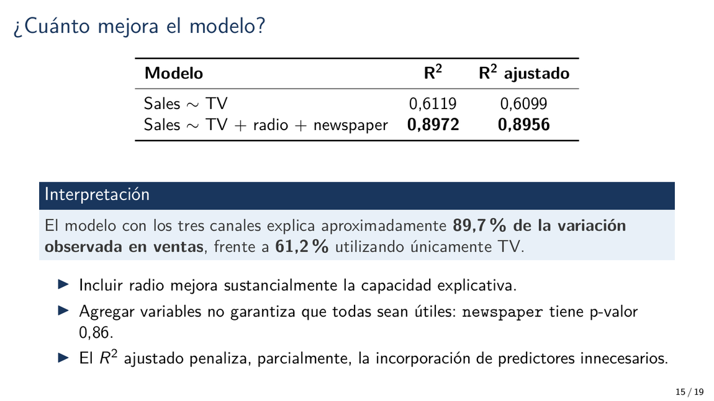

# De los datos a las decisiones con R

**Introduction to Quantitative Analysis and Linear Regression**  
*Data Analytics seminar · Universidad Abierta Interamericana (UAI) · October 8, 2026*  
**Instructor:** Brian Daniel Bernhardt



## Overview

This introductory, hands-on seminar illustrates how to move from raw data to interpretable, model-based business decisions using **R**. The case study uses the `advertising` dataset (200 observations) distributed through the `glmtoolbox` R package. It examines how advertising expenditure on **TV, radio, and newspapers** relates to product sales.

The seminar was delivered in **Spanish**. The original slides and classroom R script are shared as teaching materials.

**Guiding question:** *How can data help us understand the relationship between advertising investment and sales?*

## Learning objectives

- Inspect the structure and quality of a dataset, including missing values and duplicated rows.
- Explore distributions, bivariate plots, and correlations.
- Estimate and interpret simple and multiple linear regression with `lm()`.
- Compare model fit using R-squared and adjusted R-squared.
- Predict sales for specified advertising scenarios, including an individual prediction interval.
- Distinguish **predictive associations from causal effects**.

## Materials

| Resource | Description |
|---|---|
| [Presentation (PDF, 19 slides)](slides/intro-r-quantitative-decisions.pdf) | *De los datos a las decisiones con R: Introducción al análisis cuantitativo y a la regresión lineal* |
| [Classroom R script](scripts/advertising_eda_lm.R) | EDA, correlations, linear models, diagnostics, and marketing-budget scenarios |
| [Thumbnail](assets/thumbnail.png) | Full screenshot of slide 15 (in-sample model comparison) |

## Getting started

1. Install [R](https://cran.r-project.org/) and optionally [RStudio](https://posit.co/download/rstudio-desktop/).
2. Install the packages imported by the original seminar script:

   ```r
   install.packages(c("ISLR2", "car", "glmtoolbox", "corrplot"))
   ```

3. Open `scripts/advertising_eda_lm.R` in RStudio and run the script section by section, or run:

   ```r
   source("scripts/advertising_eda_lm.R")
   ```

   The script obtains the dataset through `data("advertising")` after loading `glmtoolbox`, so **no standalone CSV is required**.

> **Note:** The original teaching script begins with `rm(list=ls())`, which clears the objects in the current R workspace. Run it in a fresh R session. Plotting works most naturally in RStudio's Plots pane.

## Analytical workflow

```text
Data inspection and quality checks
               ↓
Exploratory data analysis and correlations
               ↓
Simple regression: sales ~ TV
               ↓
Multiple regression: sales ~ TV + radio + newspaper
               ↓
R² / adjusted R² comparison
               ↓
Scenario predictions and 95% prediction interval
               ↓
Optional model diagnostics and nonlinear TV extension
```

## Selected classroom results

The presentation reports an **in-sample R² of approximately 0.612** for the simple TV model and **0.897** for the multiple regression incorporating TV, radio, and newspaper expenditure. In the illustrative full model, TV and radio have statistically significant associations with sales; newspaper does not show evidence of a separate linear association after adjusting for the other two channels (`p ≈ 0.86`).

These are **teaching-dataset, in-sample associations**, not claims of predictive accuracy on unseen data and not causal estimates of changes to sales from altering budgets. The seminar intentionally distinguishes interpretation from causal decision-making.

## Reproducibility and scope

- The source dataset is obtained from the `glmtoolbox` package; no derived copy is bundled.
- All computations in the script use the classical R statistical toolkit and base plotting with `corrplot` and `car` for additional visualizations.
- The shared script is the original classroom file; minor informal plot labels are preserved as delivered.
- R and dependencies were **not executed in the packaging environment**; users should run the script in their own R installation.
- The original slide deck is provided unchanged. This repository is intended for teaching and illustration rather than validation of advertising effectiveness.

## Español — descripción breve

Seminario práctico impartido en la Universidad Abierta Interamericana el **8 de octubre de 2026**. Se trabaja con el conjunto de datos `advertising` para realizar controles de calidad, análisis exploratorio, correlaciones, regresión lineal simple y múltiple, interpretación de coeficientes y predicciones para escenarios de inversión publicitaria. **Los resultados representan asociaciones estadísticas, no efectos causales.**

## Data and attribution

The slides identify the `advertising` dataset as supplied through the `glmtoolbox` package, based on the Advertising example discussed by James and colleagues in *An Introduction to Statistical Learning* (2013). For scholarly use, consult the original book and package documentation.

**Author:** Brian Daniel Bernhardt · [Academic website](https://briandanielbernhardt.github.io/) · [GitHub](https://github.com/BrianDanielBernhardt)

The presentation and source script are shared for academic reference. No separate reuse license is asserted here; please contact the author regarding reuse or adaptation.
